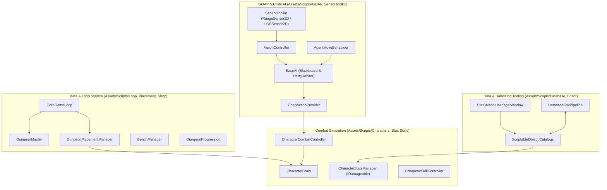

# Project Overview: SBGames

## 1. What is SBGames?

**SBGames** is a 2D Dungeon Defense / Auto-Battler RPG developed in Unity 6 (`6000.6.2f1`). 

### Core Gameplay Loop
The player acts as the **Dungeon Master**, defending their domain against incoming waves of **Adventurers**:
1. **Planning Phase**: The player manages resources (Gold & Essence), purchases monsters and items from the Shop, manages units on the Bench, places defenders onto a 2D grid/arena (`DungeonPlacementManager`), and invests in Dungeon Fame / progression talents.
2. **Battle Phase**: The battle runs as an autonomous, high-speed combat simulation. Monsters (`FactionId.Monster`) and Adventurers (`FactionId.Adventurer`) navigate the 2D NavMesh and fight using utility-driven GOAP (Goal-Oriented Action Planning) artificial intelligence.
3. **Outcome & Progression**: If defenders defeat the invaders, the dungeon gains fame and resources (`CombatResultHandler`, `DungeonProgression`, `DifficultyScaler`). If adventurers breach the defenses, dungeon essence or artifacts are lost, potentially triggering `GameOver`.

---

## 2. Core Architecture & Subsystems

### 2.1 Character & Combat Layer (`Assets/Scripts/Characters/`, `Assets/Scripts/Stat/`, `Assets/Scripts/Skills/`)
- **`CharacterBrain`**: The central actor state machine on each unit root (`IsAttacking`, `IsCastingSkill`, `CanMove`, `ControlMode`, `AgentStatus`). Toggles AI runtime via `AIActivation(bool)`.
- **`CharacterStatsManager`**: Implements `IDamageable` and manages baseline attributes (`CharacterBaseStatsSO`) modified by item modifiers (`ItemStatModifierData`) and status effects.
- **`CharacterCombatController` & `CharacterSkillController`**: Execute basic attacks and skill cooldowns/casting.
- **Damage Pipeline**: All damage must flow through `IDamageable.TakeDamage(in DamageData)`. Direct mutation of health/vitality from external controllers is forbidden.

### 2.2 Artificial Intelligence & GOAP (`Assets/Scripts/GOAP/`)
Powered by **CrashKonijn GOAP v3** (code-first, factory-configured) combined with **Utility AI**:
- **`BaseAI`**: The blackboard and utility arbiter for the agent. Caches perception, emotion/morale (`ThreatLevel`, `FearLevel`), and vitals (`AgentLife`, `AgentMana`). GOAP sensors only read from `BaseAI`; they never query physics directly.
- **`VisionController`**: Wraps Micosmo SensorToolkit (`RangeSensor2D`, `LOSSensor2D`, `RaySensor2D`). Pulses at 0.2s intervals and populates preallocated buffers on `BaseAI`.
- **`AgentMoveBehaviour`**: Drives 2D NavMesh navigation (`NavMeshPlus`) responding to `AgentBehaviour` events (`OnTargetInRange`, `OnTargetLost`). Actions do not drive movement directly.
- **Beast vs Boss Combat Archetypes (ADR-0002)**:
  - *Bosses*: Model phase transitions and enrage mechanics as high-priority GOAP Utility Goals (`BossPhaseGoal`) with immediate action interrupts.
  - *Beast Packs*: Leverage squad coordination (`PartyLeader` / `SquadMember`). Units gain **Swarm Courage** based on local ally density. If the Alpha falls or heavy casualties occur, **Morale Shock** triggers an emergency flee override.
  - *Targeting*: Data-driven via `ArchetypeThreatPolicySO` (scoring proximity, health deficit, recent damage, cluster density).

### 2.3 Balancing & Data Tooling (`Assets/Scripts/Database/`, `Assets/Scripts/Editor/`)
- **`StatBalanceManagerWindow` (ADR-0001)**: Standalone editor tool for cross-catalog balance tuning across Characters, Items, and Skills.
- **`DatabaseCsvPipeline`**: Two-way synchronization between Unity ScriptableObjects and CSV tables in `Assets/DataTables/`.
- Features in-memory dirty tracking, batch arithmetic / bulk scaling (+/- % and flat offsets), and inline validation badges.

### 2.4 Test Harness & Combat Sandbox (`Assets/Scripts/Testing/`, `docs/testing/combat_sandbox_guide.md`)
- Isolated test harness scene (`Assets/Scenes/Combat_Sandbox.unity`) allowing headless or high-speed combat simulation without loading meta game loops (Shop, Bench, Placement, Progression).
- **`CombatTestEnvironmentBootstrap`**: Boots required singletons (`ObjectPoolManager`, `GoapBehaviour`, archetype factories, NavMesh) with `[DefaultExecutionOrder(-200)]`.
- **`BattleSimulationTestRunner`**: Programmatically spawns factions and records win/loss and DPS metrics.

---

## 3. Directory Layout

| Directory | Purpose |
| :--- | :--- |
| `Assets/Scripts/Characters/` | Unit brains, combat/skill controllers, visual animation hooks. |
| `Assets/Scripts/GOAP/` | CrashKonijn GOAP v3 actions, goals, sensors, target keys, utility scorers, behaviours. |
| `Assets/Scripts/Stat/` | Stat definitions, vitality, modifiers (`DamageData`, `CharacterStatsManager`). |
| `Assets/Scripts/Skills/` | Skill definitions, projectile scripts, casting controllers. |
| `Assets/Scripts/Loop/` | Core game loop, game phases, dungeon progression, difficulty scaling, dungeon master stats. |
| `Assets/Scripts/Placement/` | Bench management, grid placement logic, deployment validation. |
| `Assets/Scripts/Shop/` | Store generation, rerolls, purchasing, economy. |
| `Assets/Scripts/Factions/` | Faction definitions (`FactionMember`, `FactionId`). |
| `Assets/Scripts/Database/` | ScriptableObject databases, CSV sync pipeline (`DatabaseCsvPipeline`). |
| `Assets/Scripts/Testing/` | Combat sandbox bootstrap, simulation runner, test harnesses. |
| `Assets/DataTables/` | CSV data tables synced with ScriptableObjects. |
| `docs/` | Architecture decision records (`docs/adr/`), AI guidelines, test guides, agent instructions. |

---

## 4. Binding Rules for Agents

### 4.1 Unity CLI Automation (Mandatory)
- **Always use the Unity CLI** (`unity` / `C:\Users\Admin\AppData\Local\Unity\bin\unity.exe`) for editor automation, testing, compilation checks, and project inspection.
- **Never use Unity MCP**.

### 4.2 AI Architecture Rules (`docs/goap_utility_context.md`)
When working in `Assets/Scripts/GOAP/` or related controllers, the rules in `docs/goap_utility_context.md` are **strictly binding**:
1. **Sense first, then act**: All target queries, physics checks, and SensorToolkit pulses belong in sensors/wrappers. `Action.Perform()` only reads cached data and executes controller calls.
2. **Perception through cached SensorToolkit wrappers**: Wrapped by `VisionController`, pulsing on a timer, written into preallocated lists on `BaseAI`.
3. **Act through interfaces and controllers**: Actions inject controllers via `[GetComponentInParent]` (`CharacterCombatController`, `CharacterStatsManager`). All damage goes through `IDamageable.TakeDamage(in DamageData)`.
4. **Reuse keys**: Reuse existing WorldKeys and TargetKeys (`GOAP/WorldKeys/`, `GOAP/TargetKeys/`) before creating new ones.
5. **Zero-allocation hot paths**: `Update`, `Sense`, `Perform`, and Utility `Evaluate` must run without managed allocations (no LINQ, no lambda allocations, use `sqrMagnitude`, use non-alloc physics).

### 4.3 Domain Vocabulary Compliance (`GLOSSARY.md`)
Always use canonical domain terms. Do not invent synonyms:
- Use **Character Base Stats** (never *base attributes*, *hero stats*).
- Use **Item Stat Modifier** (never *item perk*, *stat buff*, *affix*).
- Use **Stat Balance Matrix** (never *stat sheet*, *tuning spreadsheet*).
- Use **Bulk Scaling** (never *mass edit*, *global multiplier*).
- Use **Validation Badge** (never *error tag*, *status icon*).
- Use **Boss Phase Goal** (never *boss state machine*, *enrage script*).
- Use **Swarm Courage** (never *pack buff*, *swarm aura*).
- Use **Morale Shock** (never *fear trigger*, *pack scatter*).
- Use **Archetype Threat Policy** (never *aggro table*, *threat list*).

---

## 5. Key Reference Documents

- **Domain Glossary**: [`GLOSSARY.md`](file:///d:/UnityProject/SBGames/GLOSSARY.md)
- **GOAP & Utility AI Architecture**: [`docs/goap_utility_context.md`](file:///d:/UnityProject/SBGames/docs/goap_utility_context.md)
- **Stat Balance Manager ADR**: [`docs/adr/0001-stat-balance-manager-architecture.md`](file:///d:/UnityProject/SBGames/docs/adr/0001-stat-balance-manager-architecture.md)
- **Combat AI & Threat Prioritization ADR**: [`docs/adr/0002-dynamic-combat-ai-and-threat-prioritization.md`](file:///d:/UnityProject/SBGames/docs/adr/0002-dynamic-combat-ai-and-threat-prioritization.md)
- **Engineering & Technical Architecture Guide**: [`docs/engineering_guide.md`](file:///d:/UnityProject/SBGames/docs/engineering_guide.md)
- **Combat Sandbox & Simulation Guide**: [`docs/testing/combat_sandbox_guide.md`](file:///d:/UnityProject/SBGames/docs/testing/combat_sandbox_guide.md)
- **Agent Issue Tracker Protocol**: [`docs/agents/issue-tracker.md`](file:///d:/UnityProject/SBGames/docs/agents/issue-tracker.md)
