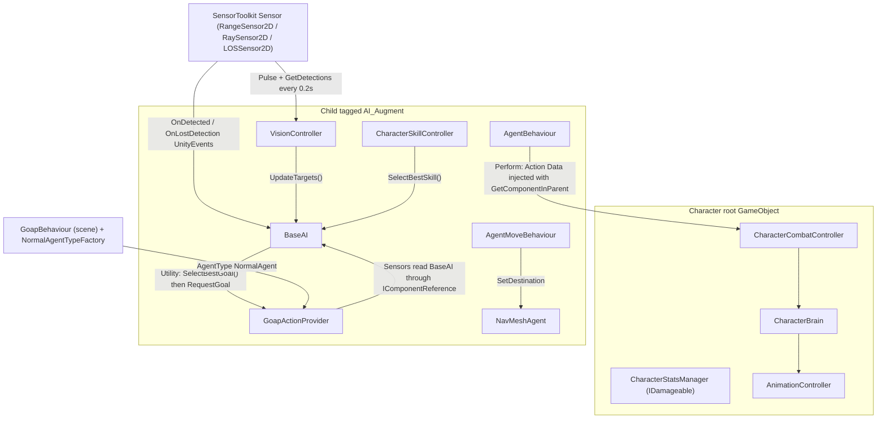

# GOAP + Utility AI Context

Reference for how the AI is put together in `Assets/Scripts/GOAP/`, and how it connects to
`Assets/Scripts/Characters/`, `Assets/Scripts/Skills/`, and Micosmo SensorToolkit
(`Assets/Plugins/SensorToolkit`). Everything here comes from the code as it is today. Places
where the code has gaps or is inconsistent are marked **⚠ Gap**.

---

## Rules

These rules apply to every change under `Assets/Scripts/GOAP/` and to the code it calls. The
current code violates some of them; each violation listed here is tagged **⚠ Gap** where the
section it points to describes it. Fix a violation when you touch that code. Don't copy it.

1. **Sense first, then act.** All querying (SensorToolkit pulses, physics, NavMesh sampling,
   target selection) happens in a WorldSensor or TargetSensor (§1.3) or in the throttled
   perception wrapper (§3.4). `Action.Perform()` only reads `Data` and `data.Target`, calls a
   controller, and returns an `ActionRunState`.
   *Status:* all current actions follow this rule.
2. **Perception goes through cached SensorToolkit wrappers.** Each `Sensor` (`RangeSensor2D`,
   `RaySensor2D`, `LOSSensor2D`) is serialized on the agent's `AI_Augment` hierarchy and
   wrapped by a component such as `VisionController`. That component pulses on a timer and
   writes into preallocated lists on `BaseAI`. GOAP sensors read those lists with
   `references.GetCachedComponent<BaseAI>()`. When an agent needs new perception, add a field
   to `BaseAI` and fill it from a wrapper (§3).
3. **Act through interfaces and controllers.** Actions inject decoupled controllers with
   `[GetComponentInParent]` (`CharacterCombatController`, `CharacterStatsManager`,
   `CharacterSkillController`). Damage is always applied through `IDamageable.TakeDamage(in DamageData)`.
   Concrete stats or health types are never mutated from GOAP code (§4).
4. **Reuse keys.** Before creating a WorldKey or TargetKey, check the inventory in §1.4 and the
   folders `GOAP/WorldKeys/` and `GOAP/TargetKeys/Target/`. Extend the meaning of an existing
   key (for example `EnemyTarget`, `ThreatLevel`, `IsSkillReady`) when it already fits. Only
   add a key for a genuinely new world fact.
5. **Zero-alloc hot paths.** Every `Update`, `Sense`, `Perform`, and Utility `Evaluate` runs
   without managed allocations (target: 60 fps):
   - pass cached `storeIn` lists to SensorToolkit queries
   - use `for`/`foreach` over `List<T>`, with no LINQ, iterators, or per-call lambdas
   - use `sqrMagnitude` for distance comparisons
   - reuse `existingTarget` through `SetTransform`/`SetPosition`
   - use `NonAlloc`/`ContactFilter2D` physics overloads with preallocated buffers

   *Violations:* see §3.3.

---

## 0. Runtime topology



- **`BaseAI`** ([BaseAI.cs](../Assets/Scripts/GOAP/AI/BaseAI.cs)) is the blackboard and the
  Utility arbiter. It caches perception (`EnemyTargets`, `AllyTargets`, `CurrentTarget`,
  `TargetDistance`), emotion (`ThreatLevel`, `FearLevel`) and resources (`AgentLife`, `AgentMana`).
  All GOAP sensors read from it. None of them query physics or SensorToolkit themselves.
- **`CharacterBrain`** ([CharacterBrain.cs](../Assets/Scripts/Characters/CharacterBrain.cs)) holds
  character state (`IsAttacking`, `IsCastingSkill`, `CanMove`, `ControlMode`, `AgentStatus`). AI
  runs only when the `AI_Augment` child is active. `AIActivation(bool)` toggles it.
- **`AgentMoveBehaviour`** ([AgentMoveBehaviour.cs](../Assets/Scripts/GOAP/Behaviours/AgentMoveBehaviour.cs))
  listens to `AgentBehaviour.Events` (`OnTargetInRange`, `OnTargetChanged`, `OnTargetNotInRange`,
  `OnTargetLost`) and drives the 2D `NavMeshAgent` through `BaseAI.AgentDestination(...)` and
  `BaseAI.IsAgentStop(...)`. Actions do **not** move the agent themselves.

---

## 1. CrashKonijn GOAP setup (v3, code-first)

The setup is done in code with factory classes. There are no ScriptableObject capability configs.

### 1.1 Goals: empty marker classes

```csharp
using CrashKonijn.Goap.Runtime;
public class KillEnemyGoal : GoalBase {}
```

Location: `GOAP/Goals/`. Current goals: `WanderGoal`, `KillEnemyGoal`, `KeepDistanceGoal`, `SurviveGoal`.
Goals carry no logic. Their conditions and base cost are declared in a **Capability** (§1.5).
Both `KeepDistanceGoal` and `SurviveGoal` are registered in `SurvivalCapabilityFactory` and paired with `FleeAction`.

### 1.2 Actions: `GoapActionBase<TData>` with a nested `Data : IActionData`

- The action class is **stateless**. Per-agent runtime state (timers, etc.) lives in `Data`.
- `Data` must expose `ITarget Target { get; set; }`.
- Character components are injected into `Data` with **`[GetComponentInParent]`** (from
  `CrashKonijn.Agent.Runtime`). This works because `BaseAI`/`AgentBehaviour` sit on the
  `AI_Augment` child and the character components sit on the root.
- `Perform` returns `ActionRunState.Continue`, `ActionRunState.Completed`, or
  `ActionRunState.WaitThenComplete(seconds)`. Combat actions use `WaitThenComplete(2f)` to cover
  the animation.
- `IsInRange` is overridden to use stats (`data.Stats.AttackRange.Value`). Movement into range is
  handled by `AgentMoveBehaviour`.

| Action | Target | Calls | Range |
|---|---|---|---|
| `WanderAction` | `WanderTarget` | none (random timer 2–5 s in `Start`) | default |
| `AttackAction` | `EnemyTarget` | `CharacterCombatController.Attack()` → `CharacterBrain.TryStartAttack()` | `Stats.AttackRange` |
| `CastSkillAction` | `EnemyTarget` | `CharacterCombatController.CastSkill()` → `CharacterBrain.TryCastSkill()` | `Stats.AttackRange` |

### 1.3 Sensors

There are two styles. Both pull data from `references.GetCachedComponent<BaseAI>()`.

**a) `MultiSensorBase`.** This is the standard way to add **WorldKeys**, and it can also register
simple local **TargetKeys**. Each key is registered once in the constructor with a lambda. The
lambda returns an `int` (implicitly converted to `SenseValue`) or an `ITarget`.

| Sensor | Registers |
|---|---|
| `AwarenessSensor` | `ThreatLevel`, `FearLevel`, `AgentLife`, `AgentMana` (world); `SelfTarget` (target) |
| `CombatStatusSensor` | `IsSkillReady` (world) |
| `EnemyDistanceSensor` | `EnemyDistance` (world, `999` when there is no target); `KeepDistanceTarget` (target, NavMesh sample) |

**b) `LocalTargetSensorBase`.** Used for TargetKeys that need more logic. You override
`Created()`, `Update()`, and `Sense(IActionReceiver, IComponentReference, ITarget existingTarget)`.
**Convention:** reuse `existingTarget` to avoid allocating a new target:

```csharp
if (existingTarget is TransformTarget t) return t.SetTransform(target);
return new TransformTarget(target);
// or PositionTarget.SetPosition(pos) / new PositionTarget(pos)
```

| Sensor | Target | Notes |
|---|---|---|
| `EnemyTargetSensor` | `EnemyTarget` | Picks a target from `BaseAI.EnemyTargets` and writes `BaseAI.SetTarget(...)` |
| `AllyTargetSensor` | (unregistered) | Same pattern over `AllyTargets` |
| `WanderTargetSensor` | `WanderTarget` | `NavMesh.SamplePosition` restricted to the area `"Territory"`, radius 3 around the agent, falling back to radius 2 around the spawn ("protect") point |

**Sensor implementation notes (resolved):**
- `EnemyTargetSensor` and `AllyTargetSensor` use zero-alloc nearest scans, null checks, and write `BaseAI.SetTarget(best, distance)`.
- `CombatStatusSensor` evaluates `data.IsSkillReady ? 1 : 0`.
- `BaseAI.TargetDistance` is maintained continuously on `BaseAI` and `EnemyTargetSensor`, feeding `EnemyDistanceSensor`.
- `KeepDistanceTarget` in `EnemyDistanceSensor` evaluates an allocation-free 2D retreat vector with zero-division safety.
- `WanderTargetSensor` samples using per-agent `BaseAI.SpawnPosition` without singleton state leak.

### 1.4 WorldKeys and TargetKeys: empty marker classes

```csharp
public class ThreatLevel : WorldKeyBase {}   // GOAP/WorldKeys/
public class EnemyTarget : TargetKeyBase {}  // GOAP/TargetKeys/Target/
```

- **WorldKeys** (all integer-valued): `AgentLife`, `AgentMana`, `EnemyDistance`, `FearLevel`,
  `IsIdle`, `IsSkillReady` (bool as 0/1), `ThreatLevel`, `HasSquadOrder` (0/1), `SquadOrderTypeKey`.
- **TargetKeys:** `EnemyTarget`, `SelfTarget`, `WanderTarget`, `KeepDistanceTarget`, `LeaderTarget`, `FocusFireTarget`.
- There is no explicit registration step. A key becomes "registered" when a capability references
  it (`AddCondition<T>`, `AddEffect<T>`, `SetTarget<T>`) and a sensor provides it
  (`AddLocalWorldSensor<T>`, `AddTargetSensor<…>().SetTarget<T>()`).
- Floats (life, mana, distance) are truncated with `(int)` casts because GOAP conditions compare integers.

### 1.5 Capabilities: `CapabilityFactoryBase` + `CapabilityBuilder`

Each capability groups related goals, actions, and sensors:

```csharp
public class AttackCapabilityFactory : CapabilityFactoryBase
{
    public override ICapabilityConfig Create()
    {
        var builder = new CapabilityBuilder("AttackCapability");

        builder.AddGoal<KillEnemyGoal>()
            .AddCondition<ThreatLevel>(Comparison.SmallerThanOrEqual, 0)
            .SetBaseCost(1);

        builder.AddAction<AttackAction>()
            .SetTarget<EnemyTarget>()
            .AddEffect<ThreatLevel>(EffectType.Decrease)
            .SetBaseCost(2);

        return builder.Build();
    }
}
```

| Capability | Goals | Actions | Sensors |
|---|---|---|---|
| `WanderCapability` | `WanderGoal` (`IsIdle >= 1`) | `WanderAction` → `IsIdle` ↑ | `WanderTargetSensor` → `WanderTarget` |
| `AttackCapability` | `KillEnemyGoal` (`ThreatLevel <= 0`) | `AttackAction` → `ThreatLevel` ↓, cost 2 | none |
| `SkillCapability` | none | `CastSkillAction` (`IsSkillReady >= 1`, `AgentMana >= 5`) → `ThreatLevel` ↓, cost 1 | none |
| `SquadCapability` | `FollowLeaderGoal`, `FocusFireGoal`, `FallBackGoal` | `FollowLeaderAction`, `FocusFireAction`, `FallBackAction` | `SquadOrderSensor`, `LeaderTargetSensor`, `FocusFireTargetSensor` |
| `SurvivalCapability` | `SurviveGoal`, `KeepDistanceGoal` | `FleeAction` → `FearLevel` ↓, cost 1 | none (`KeepDistanceTarget` provided by `EnemyDistanceSensor`) |
| `BasicCapability` | none | none | `EnemyTargetSensor` → `EnemyTarget`; multi: `AwarenessSensor`, `CombatStatusSensor`, `EnemyDistanceSensor` |

Convention: shared perception goes in **`BasicCapability`**. Feature capabilities hold their own
goal, action, and feature-specific sensors.
`CapabilityFactoryBase` is a plain C# class (`ICapabilityFactory`). It is created through
`AddCapability<T>()`, not attached to a GameObject. `AgentTypeFactoryBase` **is** a
`MonoBehaviour` and must sit on the scene's `GoapBehaviour` setup.
Minor: the file name `BasicCapabiliityFactory.cs` has a typo. This is harmless because the class
is not a MonoBehaviour.

### 1.6 AgentTypes: `AgentTypeFactoryBase`

```csharp
public class NormalAgentTypeFactory : AgentTypeFactoryBase
{
    public override IAgentTypeConfig Create()
    {
        var factory = CreateBuilder("NormalAgent");
        factory.AddCapability<WanderCapabilityFactory>();
        factory.AddCapability<AttackCapabilityFactory>();
        factory.AddCapability<SkillCapabilityFactory>();
        factory.AddCapability<BasicCapabilityFactory>();
        return factory.Build();
    }
}
```

Binding at runtime happens in `BaseAI.Awake`:

```csharp
goap = FindAnyObjectByType<GoapBehaviour>();
provider = GetComponent<GoapActionProvider>();
if (provider.AgentTypeBehaviour == null)
    provider.AgentType = goap.GetAgentType(agentType); // serialized string, default "NormalAgent"
```

To add a new archetype, create a new `AgentTypeFactoryBase` with a unique name, register it on the
scene's `GoapBehaviour`, and set `BaseAI.agentType` to that name.

---

## 2. Utility AI integration

Utility AI sits **on top of** GOAP. It decides **which goal** the agent pursues and **which skill**
it casts. GOAP still decides **how** (the action chain). Utility does **not** change action costs
or target weighting.

### 2.1 Goal selection (the Utility → GOAP bridge)

- `UtilityGoal : ScriptableObject` provides `float Evaluate(BaseAI context)` and
  `EnumUtilGoal GetGOAPGoalKey()`.
- Instances are assets (`CreateAssetMenu "SBGames/UtilityAI/Goal/..."`) assigned to
  `BaseAI.goals` in the Inspector.
- Every frame, `BaseAI.Update` calls `SelectBestGoal()`: argmax over `Evaluate`, starting from
  `highestScore = 0`. A goal must score **> 0** to win. If nothing wins, the result is
  `EnumUtilGoal.None`.
- `Planner(EnumUtilGoal)` uses a `switch` to call `provider.RequestGoal<TGoal>()`. **Each new
  utility goal needs a new enum value and a new `case`.**
- In the editor only, the inspector shows debug data: `currentGoalKey` and `goalScores`
  (a `SerializableDictionary`).

**Scoring pattern** (`UtilityKillEnemyGoal`):

```csharp
[SerializeField] AnimationCurve threatCurve = AnimationCurve.Linear(0,0,1,1);
[SerializeField] AnimationCurve fearCurve   = AnimationCurve.Linear(0,0,1,1);

public override float Evaluate(BaseAI ctx)
{
    if (ctx.ThreatLevel <= 0f) return 0;                         // hard gate
    float threat = threatCurve.Evaluate(Map(ctx.ThreatLevel, 0f, 100f)); // normalize to [0,1]
    float fear   = fearCurve.Evaluate(Map(ctx.FearLevel,   0f, 100f));
    return threat - fear;                                         // considerations combined additively
}
```

`UtilityWanderGoal` returns a constant `score = 0.4` when `ThreatLevel` and `FearLevel` are both
0, and returns 0 otherwise.

### 2.2 Emotion inputs

- `ThreatLevel` and `FearLevel` are integers on `BaseAI`. They change only through
  `SenseEnemy()` (+10 / +5) and `LostEnemy()` (−10 / −5).
- These methods are wired as **SensorToolkit UnityEvents** (`OnDetected` and `OnLostDetection`)
  in the prefab (e.g. `MONSTER_N001.prefab`). Code never calls them.
- `CalculateEmotionalState()` is an empty stub.

### 2.3 Skill selection & execution

- `UtilitySkill : ScriptableObject` provides `float Evaluate(BaseAI)` and `string GetID()`.
  **`UtilitySkill`** supports curve-based and consideration-driven evaluation:
  - Mana and health threshold gates
  - Normalized distance sweet-spot curve (`distanceCurve`)
  - Cluster / AoE multiplier curve (`clusterCurve`) querying `BaseAI.EnemiesInSkillRange(radius)`
  - Base priority weight
- How the link is resolved: `SkillData.utilityData`, falling back to
  `GameServices.UtilitySkillRuntimeDatabase.Get(skillID)`. `BaseAI.InitializeSkills()` collects
  these into `BaseAI.Skills` from `CharacterSkillController.Skills`. It runs on `Start` and again
  on `AddSkill`/`RemoveSkill`.
- `CharacterSkillController.TryCastSkillAI()` calls `BaseAI.SelectBestSkill()` (argmax, must be
  > 0) and triggers the winning skill. If no utility skill qualifies, it falls back to the first
  `IsReady` skill.
- In `CastSkillAction.Perform()`, `CharacterSkillController.TryCastSkillAI()` is called directly
  alongside `CharacterBrain.TryCastSkill()` for casting animations, while `IsInRange()` checks
  `data.SkillController.GetBestReadySkillRange()`. Clean state reset occurs on `End()` / `Stop()`.

---

## 3. SensorToolkit integration

### 3.1 Where SensorToolkit is used

GOAP sensors **never** touch SensorToolkit directly. Two character-side components wrap it,
both holding a reference to the base type `Micosmo.SensorToolkit.Sensor`. Any concrete 2D sensor
can be dropped in: `RangeSensor2D`, `RaySensor2D` (note: the class is named `RaySensor2D`, not
"RaycastSensor2D"), `LOSSensor2D`, or `TriggerSensor2D`.

| Component | Purpose |
|---|---|
| `VisionController` (Characters) | Every `SEARCH_INTERVAL = 0.2f` it calls `sensor.Pulse()`, fills `enemyTargets`, then calls `brain.UpdateTargets()`, which copies the list **reference** into `BaseAI` |
| `SkillTargeting` (Skills) | Gives skills single, chain, AoE, and beam target queries |
| Sensor UnityEvents | `OnDetected` → `BaseAI.SenseEnemy`, `OnLostDetection` → `BaseAI.LostEnemy` |

### 3.2 GC behaviour of the SensorToolkit API (from `Sensor.cs`)

- Calling `GetDetections()`, `GetSignals()`, `GetDetectionsByDistance()`, or similar **without**
  `storeIn` returns the sensor's **internal shared work list** (`objectWorkList` /
  `signalWorkList`). That is zero-alloc, but **the next query on the same sensor overwrites it**.
- Passing your own `List<T> storeIn` makes the method `Clear()` and refill it, also with no allocation.
- `GetDetectedComponents<T>(null)` and `GetDetectedComponentsByDistance<T>(null)` **allocate**
  (`new List<T>()`). Always pass a cached list.
- `GetNearestDetection()` and `GetNearestComponent<T>()` use the internal work list, so they do
  not allocate.
- `foreach` over a `List<T>` uses a struct enumerator and does not allocate.

### 3.3 Current state vs the zero-GC rule

| Code | Allocates? |
|---|---|
| `VisionController.TickPerception()`: preallocated buffers | No |
| `VisionController.GetTarget()` / `TryGetTarget()`: `foreach` + early return | No |
| `SkillTargeting.GetTargets()`: returns sensor detections without allocations | No |
| `SkillTargeting.GetAOETargets()` / `GetBeamTargets()`: zero-alloc direct list | No |
| `CharacterCombatController.SearchForTargets()`: `Physics2D.OverlapCircleNonAlloc` + cached buffer | No |
| `EnemyTargetSensor`: `for` scan over cached `List<Transform>` | No |
| `AllyTargets`: populated alongside `EnemyTargets` by `VisionController` | No |

### 3.4 Required zero-GC pattern

```csharp
using System.Collections.Generic;
using Micosmo.SensorToolkit;
using UnityEngine;

public class VisionController : MonoBehaviour
{
    [SerializeField] private Sensor sensor;      // RangeSensor2D / RaySensor2D / LOSSensor2D
    [SerializeField] private BaseAI brain;
    [SerializeField] private string enemyTag = "Adventurer";

    // Allocated once; owned by this component; read by BaseAI/GOAP sensors.
    private readonly List<GameObject> detectionBuffer = new(16);
    private readonly List<Transform>  enemyTargets    = new(16);
    public  List<Transform> EnemyTargets => enemyTargets;

    private float searchTimer;
    private const float SEARCH_INTERVAL = 0.2f;

    private void Update()
    {
        searchTimer -= Time.deltaTime;
        if (searchTimer > 0f) return;
        searchTimer = SEARCH_INTERVAL;

        sensor.Pulse();
        sensor.GetDetectionsByDistance(enemyTag, detectionBuffer); // nearest first, Clear()+fill, no alloc

        enemyTargets.Clear();
        for (int i = 0; i < detectionBuffer.Count; i++)
            enemyTargets.Add(detectionBuffer[i].transform);

        brain.UpdateTargets();
    }
}
```

Rules:
1. Pulse SensorToolkit sensors on a throttled timer, not on every GOAP sense call.
2. Copy results into a **component-owned, preallocated** list. Never keep the sensor's shared work list.
3. GOAP sensors read the cached list from `BaseAI` and do a `for`/`foreach` scan. They must not
   use LINQ, lambdas created per call, or `new List`.
4. Compare `sqrMagnitude` instead of `Vector3.Distance` in hot loops.

---

## 4. Data access and interfaces

| From | To | Mechanism |
|---|---|---|
| GOAP **Action** | Character components | `[GetComponentInParent]` properties on `Data` (`CharacterCombatController`, `CharacterStatsManager`) |
| GOAP **Sensor** | AI blackboard | `references.GetCachedComponent<BaseAI>()` |
| `BaseAI` | Stats | `CharacterStatsManager` (`Life`, `Mana`, `Movespeed.Value`), copied by `UpdateResources()` every frame |
| `BaseAI` | Movement | Its own `NavMeshAgent` (`updateRotation=false`, `updateUpAxis=false`, `speed = stats.Movespeed.Value`) |
| `CharacterCombatController` | `CharacterBrain` | `Attack()` → `TryStartAttack()`, `CastSkill()` → `TryCastSkill()`. The brain gates on `IsAttacking`, `CanAttack` (`stats.AttackReady`), and `IsCastingSkill`, then starts the animation |
| Animation events | Combat | `AnimationEventController` → `CharacterCombatController.SearchForTargets()` (melee hit). `CharacterBrain.EndAttack()` / `EndCastSkill()` reset the state |
| Skills | Damage | `SkillHitResolver.ResolveHit` → `target.TryGetComponent(out IDamageable)` → `TakeDamage(new DamageData(dmg, type, skill))`, then `StatusEffectManager.ApplyEffect` on a proc roll |
| `CharacterSkillController` | Skills | `List<Skill>`. Each `Skill` wraps a prefab's `SkillCaster` (`IsReady`, `Flags == 3` means castable, `SetupSkillCaster(targeting, spawnPoint, root)`) |

**`IDamageable`** ([IDamageable.cs](../Assets/Scripts/Interface/IDamageable.cs)), implemented by
`CharacterStatsManager` and `TrapController`:

```csharp
bool TakeDamage(in DamageData damage); // true if the hit killed the target
void TakeDamage(float damage);         // legacy
void ForceDeath();
```

**Stats** (`CharacterStatsManager`): `Life`, `Mana`, the `Stat` objects (`MaxLife`, `MaxMana`,
`Movespeed`, `Damage`, `AttackRange`, `AttackTimeInterval`, each read with `.Value`),
`AttackReady`, `TryConsumeMana(float)`, `StartAttackTimer()`, and the events `OnLifeChanged` and
`OnCharacterDeath`.

**⚠ Gap:** `CharacterCombatController.SearchForTargets()` resolves `IDamageable` but never applies
damage. It only logs.

---

## 5. Standard boilerplates

### 5.1 New Action (+ ActionData)

```csharp
// Assets/Scripts/GOAP/Actions/FleeAction.cs
using CrashKonijn.Agent.Core;
using CrashKonijn.Agent.Runtime;
using CrashKonijn.Goap.Runtime;

public class FleeAction : GoapActionBase<FleeAction.Data>
{
    // Optional: called once when the action starts. Initialise per-run state on Data here.
    public override void Start(IMonoAgent agent, Data data)
    {
        data.Timer = 1.5f;
    }

    // Required: called every frame while running. Keep it allocation-free.
    public override IActionRunState Perform(IMonoAgent agent, Data data, IActionContext context)
    {
        data.Timer -= context.DeltaTime;
        return data.Timer <= 0f ? ActionRunState.Completed : ActionRunState.Continue;
        // For animation-driven actions: trigger once, then  return ActionRunState.WaitThenComplete(2f);
    }

    // Optional: custom range check (movement into range is handled by AgentMoveBehaviour).
    public override bool IsInRange(IMonoAgent agent, float distance, Data data, IComponentReference references)
    {
        return distance <= 0.5f; // or data.Stats.AttackRange.Value
    }

    // The action class must stay stateless. All per-agent state goes here.
    public class Data : IActionData
    {
        public ITarget Target { get; set; }   // required
        public float Timer { get; set; }

        [GetComponentInParent] public CharacterCombatController Controller { get; set; }
        [GetComponentInParent] public CharacterStatsManager Stats { get; set; }
    }
}
```

Register it in a capability:

```csharp
builder.AddAction<FleeAction>()
    .SetTarget<KeepDistanceTarget>()
    .AddCondition<FearLevel>(Comparison.GreaterThanOrEqual, 1)
    .AddEffect<FearLevel>(EffectType.Decrease)
    .SetBaseCost(1);
```

### 5.2 New Goal (GOAP marker + Utility scorer + wiring)

```csharp
// Assets/Scripts/GOAP/Goals/SurviveGoal.cs
using CrashKonijn.Goap.Runtime;
public class SurviveGoal : GoalBase {}
```

```csharp
// Assets/Scripts/GOAP/UtilityAI/Goal/UtilitySurviveGoal.cs
using UnityEngine;

[CreateAssetMenu(menuName = "SBGames/UtilityAI/Goal/Survive")]
public class UtilitySurviveGoal : UtilityGoal
{
    [SerializeField] private AnimationCurve fearCurve = AnimationCurve.Linear(0, 0, 1, 1);

    public override float Evaluate(BaseAI context)
    {
        if (context.FearLevel <= 0) return 0f;                       // hard gate
        return fearCurve.Evaluate(Mathf.InverseLerp(0f, 100f, context.FearLevel));
    }

    public override EnumUtilGoal GetGOAPGoalKey() => EnumUtilGoal.Survive;
}
```

Wiring checklist:
1. Add `Survive` to `EnumUtilGoal`.
2. Add `case EnumUtilGoal.Survive: provider.RequestGoal<SurviveGoal>(); break;` to `BaseAI.Planner`.
3. In a capability: `builder.AddGoal<SurviveGoal>().AddCondition<FearLevel>(Comparison.SmallerThanOrEqual, 0).SetBaseCost(1);`
4. Make sure some action has the matching effect (`AddEffect<FearLevel>(EffectType.Decrease)`).
5. Create the asset and add it to `BaseAI.goals` on the prefab.

### 5.3 New Sensor

**WorldKey, via `MultiSensorBase` (project standard):**

```csharp
// Assets/Scripts/GOAP/WorldKeys/HasTarget.cs
using CrashKonijn.Goap.Runtime;
public class HasTarget : WorldKeyBase {}
```

```csharp
// Assets/Scripts/GOAP/Sensors/TargetStatusSensor.cs
using CrashKonijn.Goap.Runtime;

public class TargetStatusSensor : MultiSensorBase
{
    public override void Created() { }
    public override void Update() { }

    public TargetStatusSensor()
    {
        // Lambdas are created once here (no per-sense allocation).
        this.AddLocalWorldSensor<HasTarget>((agent, references) =>
        {
            var ai = references.GetCachedComponent<BaseAI>();
            if (ai == null) return 0;
            return ai.CurrentTarget != null ? 1 : 0;   // int → SenseValue
        });
    }
}
// Register: builder.AddMultiSensor<TargetStatusSensor>();
```

**TargetKey, via `LocalTargetSensorBase`** (allocation-free nearest scan, reusing `existingTarget`):

```csharp
// Assets/Scripts/GOAP/Sensors/NearestEnemyTargetSensor.cs
using CrashKonijn.Agent.Core;
using CrashKonijn.Goap.Runtime;
using UnityEngine;

public class NearestEnemyTargetSensor : LocalTargetSensorBase
{
    public override void Created() { }
    public override void Update() { }

    public override ITarget Sense(IActionReceiver agent, IComponentReference references, ITarget existingTarget)
    {
        var ai = references.GetCachedComponent<BaseAI>();
        var list = ai != null ? ai.EnemyTargets : null;   // cached by VisionController (SensorToolkit)
        if (list == null || list.Count == 0) return null;

        Vector3 origin = agent.Transform.position;
        Transform best = null;
        float bestSqr = float.MaxValue;

        for (int i = 0; i < list.Count; i++)
        {
            var t = list[i];
            if (t == null) continue;
            float sqr = (t.position - origin).sqrMagnitude;
            if (sqr < bestSqr) { bestSqr = sqr; best = t; }
        }

        if (best == null) return null;
        ai.SetTarget(best);

        if (existingTarget is TransformTarget tt) return tt.SetTransform(best);
        return new TransformTarget(best);
    }
}
// Register: builder.AddTargetSensor<NearestEnemyTargetSensor>().SetTarget<EnemyTarget>();
```

---

## 6. Quick checklist for adding AI behaviour

1. Add the WorldKey/TargetKey marker classes in `GOAP/WorldKeys` or `GOAP/TargetKeys/Target`.
2. Add a sensor that feeds the key from `BaseAI`. If new perception data is needed, add the field
   to `BaseAI` and fill it from a SensorToolkit wrapper using the zero-GC pattern (§3.4).
3. Add the Action (stateless, data in `Data`, components through `[GetComponentInParent]`).
4. Add the Goal marker, plus a `UtilityGoal` asset, an `EnumUtilGoal` value, and a `Planner` case.
5. Register everything in a `CapabilityFactoryBase`, and add that capability to the
   `AgentTypeFactoryBase`.
