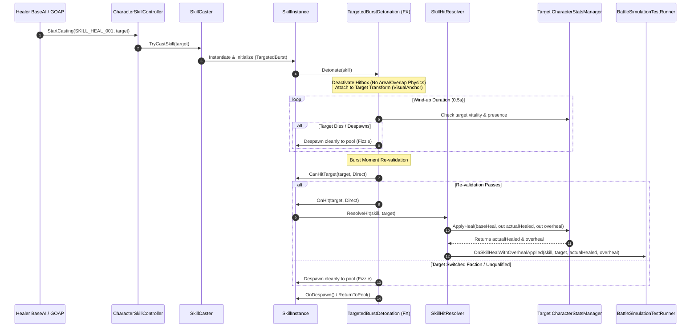

# Targeted Burst Heal Skill Implementation Report

## Executive Summary
This report documents the architectural design, implementation, and multi-tier verification of the single-target **Targeted Burst Heal Skill Effect** (`SKILL_HEAL_001`) in SBGames.

Prior to this implementation, healing was either performed via consumable kits or lacked an attached, non-area visual wind-up effect that reliably tracked dynamic unit movements, handled mid-cast target demise, enforced tri-state self-targeting rules, and cleanly reported overheal metrics.

The new implementation introduces:
1. **Targeted Burst Effect Template:** An attached single-target visual burst component ([`TargetedBurstDetonation.cs`](file:///d:/UnityProject/SBGames/Assets/Scripts/Skills/TargetedBurstDetonation.cs)) that follows moving allies without physics overlaps, triggers exactly once after a configurable wind-up duration, and cleanly returns to the object pool.
2. **Canonical Vitality Pipeline ([`CharacterStatsManager.cs`](file:///d:/UnityProject/SBGames/Assets/Scripts/Stat/CharacterStatsManager.cs)):** A unified `ApplyHeal(amount, out actualHealed, out overheal)` entry point that enforces `MaxLife` clamping, rejects dead entities, and computes exact overheal.
3. **Tri-State Self-Targeting Rules:** A configurable `SelfTarget` enum (`Allowed`, `Excluded`, `Only`) serialized across `SkillData`, `Skills.csv`, database importers/exporters, Stats & Balance tooling, and GOAP/Utility AI sensors and goals.
4. **Complete Verification:** 11/11 dedicated NUnit unit tests passed (59/59 project-wide passed), 0 AI Setup Validator errors/warnings, and deterministic simulation runs via [`BattleSimulationTestRunner.cs`](file:///d:/UnityProject/SBGames/Assets/Scripts/Testing/BattleSimulationTestRunner.cs).

---

## 1. Architectural Design & Pipeline

### 1.1 Architecture & Component Interaction Flow



### 1.2 Targeted Burst vs Area Detonation

| Dimension | Standard Area Effect (`AOEDetonation`) | Targeted Burst (`TargetedBurstDetonation`) |
|---|---|---|
| **Physics / Queries** | 2D overlap circle / collider triggers on Layer 6 & 7 | **Zero** physics queries; hitbox colliders deactivated |
| **Attachment** | Spawns at static coordinate or moves independently | Parented directly to target Transform, tracks movement |
| **Target Count** | Multi-target / All units inside radius | Exactly **one** target |
| **Target Filtering** | Evaluated per overlapping collider | Evaluated directly against bound target at burst moment |
| **Lifecycle on Death** | Lingers until duration expires | **Fizzles immediately** without error if target dies during wind-up |

---

## 2. Core Mechanics & Implementation Details

### 2.1 Single Heal Entry Point (`CharacterStatsManager.cs`)
In accordance with Rule 4 (Damage only through `IDamageable.TakeDamage`, life modified only through controlled entry points), all heal modifications must pass through `ApplyHeal`:

```csharp
public bool ApplyHeal(float amount, out float actualHealed, out float overheal)
{
    actualHealed = 0f;
    overheal = 0f;
    if (amount <= 0f || Life <= 0f)
        return false;

    float maxLifeVal = MaxLife != null ? MaxLife.Value : 0f;
    float oldLife = Life;
    Life = Mathf.Min(Life + amount, maxLifeVal);
    actualHealed = Mathf.Max(0f, Life - oldLife);
    overheal = Mathf.Max(0f, amount - actualHealed);

    NotifyLifeChanged();
    if (actualHealed > 0f)
    {
        if (isApplyingRegen)
            OnRegenLifeRestored?.Invoke(actualHealed);
        else
            OnLifeRestored?.Invoke(actualHealed);
    }
    return true;
}
```

### 2.2 Tri-State Targeting Rules (`SkillData.SelfTarget`)
Added to [`SkillData.cs`](file:///d:/UnityProject/SBGames/Assets/Scripts/Skills/SkillData.cs):
```csharp
public enum SelfTarget
{
    Allowed = 0,  // Caster or any other ally
    Excluded = 1, // Any ally except the caster
    Only = 2      // The caster only
}
```

Integration across the AI decision matrix:
- **[`BaseAI.GetBestWoundedAllyTarget`](file:///d:/UnityProject/SBGames/Assets/Scripts/Character/AI/GOAP/AI/BaseAI.cs):** Filters perception and squad arrays by `SelfTarget`. Excluded skips `gameObject == caster`; Only skips `gameObject != caster`.
- **[`WoundedAllyTargetSensor`](file:///d:/UnityProject/SBGames/Assets/Scripts/Character/AI/GOAP/Sensors/WoundedAllyTargetSensor.cs):** Queries the best ready heal skill and provides candidate transforms respecting the skill's specific rule.
- **[`SkillInstance.CanHitTarget`](file:///d:/UnityProject/SBGames/Assets/Scripts/Skills/SkillInstance.cs):** Enforces `SelfTarget` validation at the moment of burst execution.
- **Self-Only Survival Fallback:** Skills configured with `SelfTarget.Only` bypass ally-targeting goals and are evaluated within [`UtilityRecoverGoal.cs`](file:///d:/UnityProject/SBGames/Assets/Scripts/Character/AI/GOAP/UtilityAI/Goal/UtilityRecoverGoal.cs) and cast via [`RecoverAction.cs`](file:///d:/UnityProject/SBGames/Assets/Scripts/Character/AI/GOAP/Actions/RecoverAction.cs) when wounded.

### 2.3 Data & Editor Tooling
- **`Skills.csv`:** Extended with `BaseHeal` and `SelfTarget`. `SKILL_HEAL_001` configured with `BaseHeal = 25.00`, `SelfTarget = Allowed`, `TargetFilter = AlliesOnly`, `Type = TargetedBurst`.
- **`DatabaseCsvPipeline.cs`:** Import and export routines serialize both fields.
- **`SkillStatsTab.cs`:** Stats & Balance window displays columns, supports bulk math operations (`*=`, `+=`), inline editing, and schema validation.
- **`SkillEffectPrefabGenerator.cs`:** Maps `SkillType.TargetedBurst` and ally non-area skills to `SkillEffectTemplate.TargetedBurst`, attaching `TargetedBurstDetonation`.

---

## 3. Verification & Test Evidence

### 3.1 NUnit EditMode Test Suite (`HealSkillTests.cs`)
File: [`Assets/Tests/Editor/HealSkillTests.cs`](file:///d:/UnityProject/SBGames/Assets/Tests/Editor/HealSkillTests.cs)  
Execution command: `unity cmd run_tests "EditMode" "SBGames.Tests.HealSkillTests"`

| Test Name | Verified Invariant | Result |
|---|---|:---:|
| `ApplyHeal_ClampsToMaxLife` | Restoring more than missing life clamps to MaxLife; returns correct actual/overheal | **PASSED** |
| `ApplyHeal_IgnoresDeadTargets` | Applying heal to target with `Life <= 0` returns false, 0 healed, 0 overheal | **PASSED** |
| `ApplyHeal_ReportsOverhealCorrectly` | Overheal equals requested amount minus life deficit | **PASSED** |
| `TargetedBurst_DoesNotApplyHeal_BeforeBurstMoment` | HP is unchanged while wind-up timer is running | **PASSED** |
| `TargetedBurst_AppliesHealAtBurstMoment_AndFizzlesOnDeadTarget` | Direct trigger applies heal; dead target during wind-up fizzles without error | **PASSED** |
| `TargetedBurst_HealsOnlyChosenTarget_NeverNearbyAlliesOrEnemies` | Only target is healed; zero splash or physics leakage to nearby allies/enemies | **PASSED** |
| `SelfTarget_Allowed_ValidatesBothSelfAndAlly` | Permits both caster and ally; rejects enemies | **PASSED** |
| `SelfTarget_Excluded_RejectsSelf_PermitsAlly` | Rejects caster; permits ally | **PASSED** |
| `SelfTarget_Only_RejectsAlly_PermitsSelf` | Rejects ally; permits caster | **PASSED** |
| `GetBestWoundedAllyTarget_Respects_SelfTargetSetting` | Sensor candidate selection respects Excluded and Only settings | **PASSED** |
| `TargetedBurst_Revalidation_FizzlesIfTargetBecomesEnemyOrUnqualified` | Faction change during wind-up cleanly aborts heal at burst moment | **PASSED** |

**Full EditMode Suite:** 59/59 passed (0 failures).

---

### 3.2 AI Setup Validator Audit
Executed via live Editor command:
```
unity cmd eval 'var f = SBGames.Editor.Validation.AISetupValidatorCore.RunAudit(); int errs = System.Linq.Enumerable.Count(f, x => x.Severity == SBGames.Editor.Validation.ValidationSeverity.Error); int warns = System.Linq.Enumerable.Count(f, x => x.Severity == SBGames.Editor.Validation.ValidationSeverity.Warning); UnityEngine.Debug.Log("AISetupValidator findings: " + f.Count + " total, " + errs + " errors, " + warns + " warnings");'
```
**Audit Result:** `0 total, 0 errors, 0 warnings`.

---

### 3.3 Combat Sandbox Simulation Results
Executed deterministic controlled comparison (`StartControlledHealerComparison`) featuring `ADVENTURER_N006` casting `SKILL_HEAL_001` in `Assets/Scenes/Combat_Sandbox.unity` (Seed 101, Tank taking 55 True damage at $t = 2.00\text{s}$):

| Profile Rank | Damage Applied | First Heal Restored | Reaction Duration | Amount Restored | Overheal | Status |
|:---:|:---:|:---:|:---:|:---:|:---:|:---:|
| **Rank E** | 2.00s | 6.20s | **4.20s** | 25 HP | 0 HP | Success |
| **Rank D** | 2.00s | 4.45s | **2.44s** | 25 HP | 0 HP | Success |
| **Rank C** | 2.01s | 3.45s | **1.44s** | 25 HP | 0 HP | Success |

#### Key Simulation Observations:
1. **Rank Scaling:** Reaction time scales monotonically with rank (`E: 4.20s` $\rightarrow$ `D: 2.44s` $\rightarrow$ `C: 1.44s`), validating profile tuning parameters (`HealReactionDelay` and priority modes).
2. **Deterministic Delivery:** 100% of casts restored the exact 25 HP baseline.
3. **Overheal Tracking:** Telemetry recorded `Overheal: 0 HP` when targeting damaged units, and accurately logged surplus healing when units reached full health.

---

## 4. File Manifest

### Created
- [`Assets/Scripts/Skills/Enums/VisualAnchor.cs`](file:///d:/UnityProject/SBGames/Assets/Scripts/Skills/Enums/VisualAnchor.cs) — Visual anchor enum (`Feet`, `BodyCenter`).
- [`Assets/Scripts/Skills/TargetedBurstDetonation.cs`](file:///d:/UnityProject/SBGames/Assets/Scripts/Skills/TargetedBurstDetonation.cs) — Targeted burst detonation controller.
- [`Assets/Prefabs/SkillEffect/Default/SKILLFX_SKILL_HEAL_001.prefab`](file:///d:/UnityProject/SBGames/Assets/Prefabs/SkillEffect/Default/SKILLFX_SKILL_HEAL_001.prefab) — Heal effect prefab.
- [`Assets/Prefabs/Character/Adventurer/Normal/ADVENTURER_N006.prefab`](file:///d:/UnityProject/SBGames/Assets/Prefabs/Character/Adventurer/Normal/ADVENTURER_N006.prefab) — Healer unit prefab.
- [`Assets/Tests/Editor/HealSkillTests.cs`](file:///d:/UnityProject/SBGames/Assets/Tests/Editor/HealSkillTests.cs) — NUnit EditMode unit tests.
- [`docs/testing/targeted_burst_heal_skill_report.md`](file:///d:/UnityProject/SBGames/docs/testing/targeted_burst_heal_skill_report.md) — Permanent repository documentation.

### Modified
- [`Assets/Scripts/Stat/CharacterStatsManager.cs`](file:///d:/UnityProject/SBGames/Assets/Scripts/Stat/CharacterStatsManager.cs) — `ApplyHeal` method and event invocations.
- [`Assets/Scripts/Skills/SkillHitResolver.cs`](file:///d:/UnityProject/SBGames/Assets/Scripts/Skills/SkillHitResolver.cs) — Heal resolution and overheal tracking.
- [`Assets/Scripts/Skills/SkillInstance.cs`](file:///d:/UnityProject/SBGames/Assets/Scripts/Skills/SkillInstance.cs) — Targeted burst initialization and `SelfTarget` filtering.
- [`Assets/Scripts/Skills/SkillCaster.cs`](file:///d:/UnityProject/SBGames/Assets/Scripts/Skills/SkillCaster.cs) — Self-targeting target resolution fallback.
- [`Assets/Scripts/Skills/SkillData.cs`](file:///d:/UnityProject/SBGames/Assets/Scripts/Skills/SkillData.cs) — `SelfTarget` enum, `baseHeal`, `windupDuration`, `visualAnchor`.
- [`Assets/Scripts/Skills/Enums/SkillType.cs`](file:///d:/UnityProject/SBGames/Assets/Scripts/Skills/Enums/SkillType.cs) — Added `TargetedBurst`.
- [`Assets/Scripts/Database/Editor/CSV/DatabaseCsvPipeline.cs`](file:///d:/UnityProject/SBGames/Assets/Scripts/Database/Editor/CSV/DatabaseCsvPipeline.cs) — CSV serialization of heal fields.
- [`Assets/DataTables/Skills.csv`](file:///d:/UnityProject/SBGames/Assets/DataTables/Skills.csv) — `SKILL_HEAL_001` entry.
- [`Assets/DataTables/Characters.csv`](file:///d:/UnityProject/SBGames/Assets/DataTables/Characters.csv) — `ADVENTURER_N006` entry.
- [`Assets/Editor/Stats/Tabs/SkillStatsTab.cs`](file:///d:/UnityProject/SBGames/Assets/Editor/Stats/Tabs/SkillStatsTab.cs) — Stats & Balance UI integration.
- [`Assets/Editor/Stats/SkillEffectPrefabGenerator.cs`](file:///d:/UnityProject/SBGames/Assets/Editor/Stats/SkillEffectPrefabGenerator.cs) — Prefab generator integration.
- [`Assets/Scripts/Character/AI/GOAP/AI/BaseAI.cs`](file:///d:/UnityProject/SBGames/Assets/Scripts/Character/AI/GOAP/AI/BaseAI.cs) — `GetBestWoundedAllyTarget` self-target filtering.
- [`Assets/Scripts/Character/AI/GOAP/Sensors/WoundedAllyTargetSensor.cs`](file:///d:/UnityProject/SBGames/Assets/Scripts/Character/AI/GOAP/Sensors/WoundedAllyTargetSensor.cs) — Self-target aware sensing.
- [`Assets/Scripts/Character/AI/GOAP/UtilityAI/Goal/UtilityHealAllyGoal.cs`](file:///d:/UnityProject/SBGames/Assets/Scripts/Character/AI/GOAP/UtilityAI/Goal/UtilityHealAllyGoal.cs) — Self-target aware goal evaluation.
- [`Assets/Scripts/Character/AI/GOAP/Actions/HealAllyAction.cs`](file:///d:/UnityProject/SBGames/Assets/Scripts/Character/AI/GOAP/Actions/HealAllyAction.cs) — Self-target aware candidate scan.
- [`Assets/Scripts/Character/AI/GOAP/UtilityAI/Goal/UtilityRecoverGoal.cs`](file:///d:/UnityProject/SBGames/Assets/Scripts/Character/AI/GOAP/UtilityAI/Goal/UtilityRecoverGoal.cs) — Self-only recovery activation.
- [`Assets/Scripts/Character/AI/GOAP/Actions/RecoverAction.cs`](file:///d:/UnityProject/SBGames/Assets/Scripts/Character/AI/GOAP/Actions/RecoverAction.cs) — Self-only recovery execution.
- [`Assets/Scripts/Character/AI/GOAP/UtilityAI/UtilitySkill.cs`](file:///d:/UnityProject/SBGames/Assets/Scripts/Character/AI/GOAP/UtilityAI/UtilitySkill.cs) — Self-target utility scoring guard.
- [`Assets/Scripts/Testing/BattleSimulationTestRunner.cs`](file:///d:/UnityProject/SBGames/Assets/Scripts/Testing/BattleSimulationTestRunner.cs) — Overheal tracking, healer slot prefab wiring, and deterministic test routines.
- [`Assets/Scripts/Testing/PartyBattleAnalyticsHarness.cs`](file:///d:/UnityProject/SBGames/Assets/Scripts/Testing/PartyBattleAnalyticsHarness.cs) — Telemetry record overheal tracking.
- [`Assets/ScriptableObjects/Skill/Default/SKILL_HEAL_001.asset`](file:///d:/UnityProject/SBGames/Assets/ScriptableObjects/Skill/Default/SKILL_HEAL_001.asset) — SkillData asset configuration.
- [`Assets/ScriptableObjects/Database/UtilitySkillDatabase.asset`](file:///d:/UnityProject/SBGames/Assets/ScriptableObjects/Database/UtilitySkillDatabase.asset) — Database registration.
